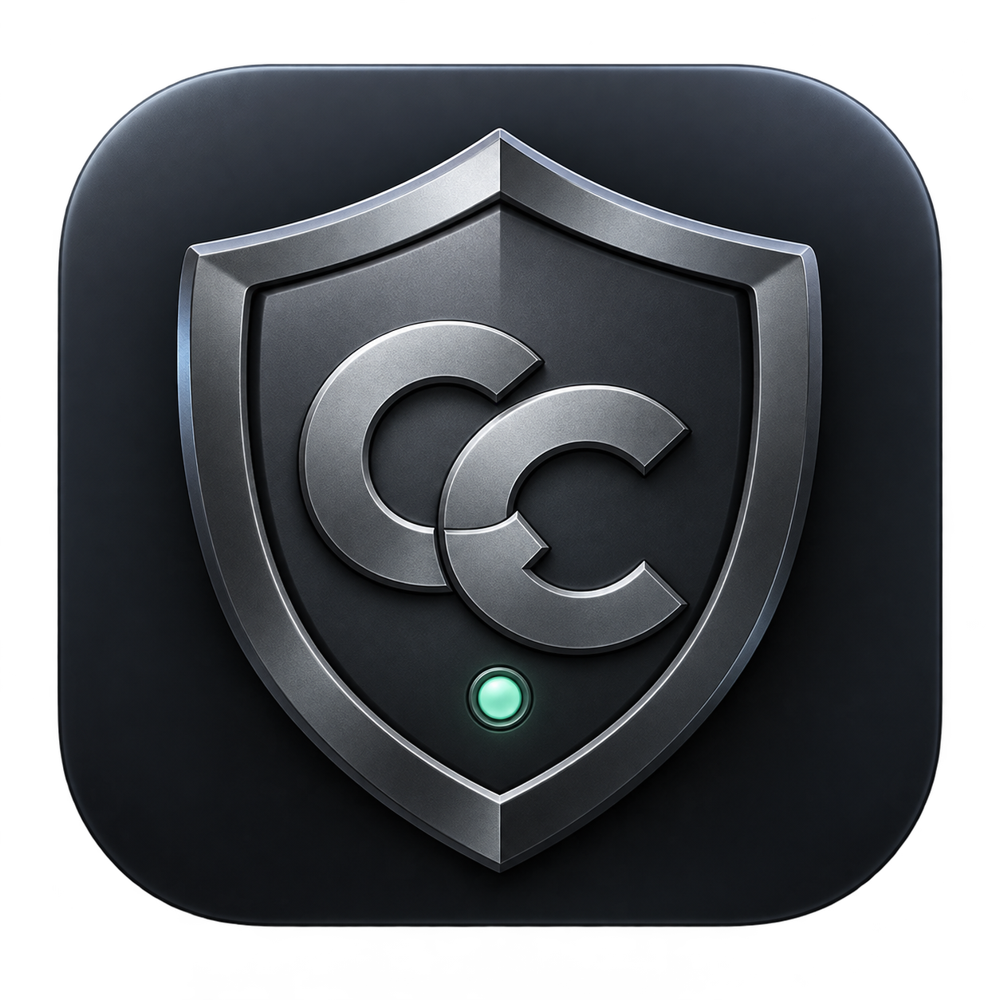
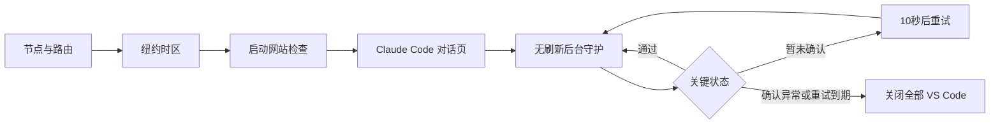

<div align="center">
  
  <h1>CCGuard · CC 登录器</h1>
  <p>先检查环境，再打开 Claude Code；使用期间在后台持续核验。</p>
  <p>A native macOS launcher and background environment guard for Claude Code.</p>
</div>

**0.3.1 · macOS 14+ · Apple Silicon · SwiftUI / AppKit · MIT**

CCGuard 把节点、时区、网络检查和 Claude Code 启动串成一个流程，并提供无刷新后台探测、错误历史和圆形磨砂小浮窗。适合使用 Shadowrocket 智能分流、希望在使用前核验指定出口的个人开发者。

> **使用前保存工作。** 确认关键环境异常时，CCGuard 会强制关闭当前用户的所有官方 VS Code 窗口及关联子进程，可能丢失未保存内容。它不提供账号登录代理，也不承诺账号安全、无封禁或每条请求的实际路由。

## 功能

| 功能 | 行为 |
| --- | --- |
| 四步启动检查 | 指定 Shadowrocket 节点与配置路由 → 纽约时区 → 网站完整检查与出口探测 → 确认实际 Claude Code 对话页 |
| 启动网络门槛 | 评分严格大于 90；住宅、支持地区和风险项仅在每次启动时检查 |
| 智能分流 | 国内 IPv4 可走本地真实出口；Claude 与 Cloudflare 出口仍匹配配置值 |
| 无刷新后台探测 | 原生请求核验出口和连通性，专用浏览器隔离上下文重新探测 DNS / WebRTC，不刷新检测网页 |
| 区分异常与未知 | 确认关键异常立即撤销；暂时无结果每 10 秒重试，连续 120 秒未完整恢复才撤销 |
| 独立守护 | 主窗口关闭后继续运行；独立进程在主程序退出或心跳失效时接管退出处理 |
| 报错历史 | 本地保存、跨启动查看、错误/提示筛选、搜索和原始日志定位 |
| 轻量浮窗 | 圆形磨砂玻璃、70% 背景透明、白字，仅显示状态和出口 IP；可拖动、双击及右键操作 |
| 辅助窗口收起 | 四步通过后收起检测及辅助窗口，VS Code 留在前台 |



## 快速开始

准备 Apple Silicon Mac、macOS 14 或以上，以及官方安装的 **Shadowrocket、Google Chrome、VS Code 和 Claude Code 扩展**。程序不会替你购买、配置或提供代理服务。

1. 构建并打开 App，授予辅助功能权限。
2. 填写自己的节点全名、指定出口 IPv4 和工作目录。新安装不预填任何个人节点、IP 或账号。
3. 手动将系统时区设置为 `America/New_York`；兼容的时区工具也可选填，见[使用说明](docs/使用说明.md)。
4. 保存并退出已有 VS Code，再点击“检查并启动”。

当前公开版是源代码发行；本地构建采用 ad-hoc 签名，**未经过 Apple 公证**。其他 Mac、Shadowrocket/Chrome/扩展版本与代理规则需要自行验证。构建产物默认写入 `dist/`，不要将个人运行日志或设置上传到仓库。

## 构建和测试

需要 Xcode 命令行工具（Swift 6+），脚本测试另需 Node.js 22+。

```sh
git clone https://github.com/zhongqingqiang01-ship-it/CCGuard.git
cd CCGuard
scripts/check.sh
scripts/build.sh
```

运行 `dist/CC登录器.app`。`NODE_BIN=/path/to/node scripts/check.sh` 可指定 Node。版本和构建号维护在 `Resources/Info.plist`。

默认测试使用脱敏样例，不打开网站、不登录外部账号、不启动或关闭真实 VS Code。`scripts/verify-watchdog.py` 使用独立测试进程检查守护行为；完整实际启停验收应先保存工作并明确授权。

## 设计与限制

- **手动启动拦截未实现。** 直接从 Dock、Spotlight 或 `code` 打开 VS Code 不会自动启动 CCGuard。
- 运行中不重复查询评分、住宅属性和风险项；界面“启动评分”是本次启动的历史结果。
- 依赖第三方检测站、DNS / STUN 服务和辅助功能控件。网络、网站结构或应用版本变化可能使检测不可用。
- DNS / WebRTC 使用网站对应的观察口径。未观察到出口不等于所有应用都不存在泄露；HTTP 探测不等于对每条真实 Claude 请求抓包验证。
- 目前面向本地官方 Claude Code 网络；不支持自动证明自定义 API、第三方模型提供方或独立 VS Code 代理的实际路径。
- 休眠唤醒、权限丢失、明确的网络接口变化或守护失效会要求重新检查。异常后不自动重启 VS Code。
- 窗口关闭或隐藏浮窗不会解除守护；“结束使用”和退出 App 会先结束受管 VS Code。

详见[使用说明](docs/使用说明.md)、[架构与规则](docs/架构与规则.md)、[验证范围](docs/验证范围.md)、[隐私说明](PRIVACY.md)和[安全报告](SECURITY.md)。

## 项目结构

```text
Sources/CCGuardApp/   macOS 界面、系统适配、浏览器和网络探测
Sources/CCGuardCore/  可测试的策略、流程、历史和进程选择规则
Tests/               单元测试及文档专用 IP 固定样例
Resources/           图标、脚本和 App 元数据
scripts/             构建、隐私检查和隔离验证入口
docs/                使用、架构与验证边界
```

## 参与和协议

请先阅读 [CONTRIBUTING.md](CONTRIBUTING.md)。提交问题前删除真实 IP、节点名、账号、密钥、私人路径和会话内容；安全问题不要公开粘贴完整日志。

代码采用 [MIT](LICENSE) 协议。CCGuard 是独立项目，与 Apple、Anthropic、Microsoft、Shadowrocket 或检测网站没有官方隶属关系；第三方产品、网络服务与账号使用仍受各自条款约束。图标与外部依赖说明见 [NOTICE.md](NOTICE.md)。
